

  
    
  
  

 

  <code>PALANPUR, INDIA</code> &nbsp; / &nbsp; <code>IT ENGINEERING</code> &nbsp; / &nbsp; <code>SOFTWARE · SECURITY · AI</code>

 

  

---

## A little about me

I’m **Yashraj Desai** — an IT Engineering student who likes figuring out how things work, then turning those questions into useful software.

My interests move between **frontend and full-stack development, networking, cybersecurity, and AI/ML**. I’m especially drawn to projects where a strong technical foundation meets a thoughtful user experience.

  

## Selected work  / PROJECT INDEX 001—006

<table>
  <tr>
    <td width="50%" valign="top">
      <a href="https://github.com/Yashrajdesai99/museo"></a>
      <h3><a href="https://github.com/Yashrajdesai99/museo">01 / MUSEO ↗</a></h3>
      A digital museum experience exploring how technology can make cultural spaces feel more immersive, welcoming, and accessible.
        <code>TypeScript</code> &nbsp; <code>INTERACTIVE EXPERIENCE</code>
    </td>
    <td width="50%" valign="top">
      <a href="https://github.com/Yashrajdesai99/PriceSentinel"></a>
      <h3><a href="https://github.com/Yashrajdesai99/PriceSentinel">02 / PRICESENTINEL ↗</a></h3>
      A Python project focused on price monitoring. Built as part of my journey toward practical, useful automation.
        <code>PYTHON</code> &nbsp; <code>MONITORING</code>
    </td>
  </tr>
  <tr>
    <td width="50%" valign="top">
      <a href="https://github.com/Yashrajdesai99/smart-study-tracker"></a>
      <h3><a href="https://github.com/Yashrajdesai99/smart-study-tracker">03 / SMART STUDY TRACKER ↗</a></h3>
      A study-tracking project centered on making learning tasks and progress easier to organise.
        <code>PYTHON</code> &nbsp; <code>PRODUCTIVITY</code>
    </td>
    <td width="50%" valign="top">
      <a href="https://github.com/Yashrajdesai99/Personal-Expense-Tracker"></a>
      <h3><a href="https://github.com/Yashrajdesai99/Personal-Expense-Tracker">04 / EXPENSE TRACKER ↗</a></h3>
      A personal finance utility project for recording expenses and bringing everyday spending into focus.
        <code>PYTHON</code> &nbsp; <code>PERSONAL UTILITY</code>
    </td>
  </tr>
  <tr>
    <td width="50%" valign="top">
      <a href="https://github.com/Yashrajdesai99/python-journey"></a>
      <h3><a href="https://github.com/Yashrajdesai99/python-journey">05 / PYTHON JOURNEY ↗</a></h3>
      A living collection of practice, experiments, and progress while learning Python by building.
        <code>PYTHON</code> &nbsp; <code>LEARNING IN PUBLIC</code>
    </td>
    <td width="50%" valign="top">
      <a href="https://github.com/Yashrajdesai99/Yashrajdesai99"></a>
      <h3><a href="https://github.com/Yashrajdesai99/Yashrajdesai99">06 / PROFILE SOURCE ↗</a></h3>
      The code and visual system behind this profile: custom SVG artwork, motion studies, and the README itself.
        <code>MARKDOWN</code> &nbsp; <code>SVG</code>
    </td>
  </tr>
</table>

## Tools, systems, and curiosity

  

**Programming** — Python · Java · JavaScript · TypeScript  
**Interface & web** — HTML · CSS · React · Node.js  
**Data & workflow** — MySQL · Git · GitHub · VS Code · Linux  
**Exploring** — Networking · Cybersecurity · AI/ML · Interactive 3D

> I’m still learning. The point is to stay curious, build real things, and get a little better with every iteration.

## What I value

  

- **Build to understand.** Concepts stick when I turn them into something that works.
- **Explore beneath the surface.** I’m interested in why systems behave the way they do, not only how to use them.
- **Design the experience.** Useful software should feel considered, not just functional.
- **Keep refining.** Every project is another chance to improve the craft.

## Activity trace

  
  

---

  
    
  <a href="https://github.com/Yashrajdesai99?tab=repositories">VIEW THE PROJECT ARCHIVE ↗</a>
  &nbsp;&nbsp; / &nbsp;&nbsp;
  <a href="https://github.com/Yashrajdesai99">FOLLOW THE JOURNEY ↗</a>
    
  <code>YASHRAJ.EXE</code> &nbsp;—&nbsp; A PERSONAL BUILD LOG, NOT A FINISHED PRODUCT.

