

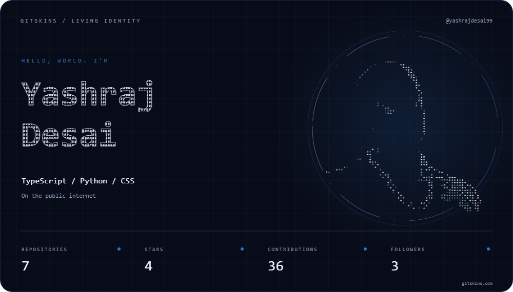

# YASHRAJ DESAI.

### IT ENGINEERING STUDENT · CREATIVE DEVELOPER · SYSTEMS EXPLORER

**Building useful things. Learning every day.**

&nbsp;

PALANPUR, GUJARAT, INDIA &nbsp; / &nbsp; SOFTWARE · CYBERSECURITY · AI/ML

---

## 00 / THE POINT OF VIEW

I’m **Yashraj Desai**, an IT Engineering student who enjoys figuring out how systems work and turning ideas into practical projects. I’m exploring the space between software engineering, thoughtful interfaces, networking, cybersecurity, and AI/ML.

I learn by building: experiment, break things safely, understand what happened, then improve the result. I’m open to thoughtful collaboration and useful open source.


## 01 / SELECTED EXPERIMENTS

<table>
<tr>
<td width="50%" valign="top">
<a href="https://github.com/Yashrajdesai99/museo">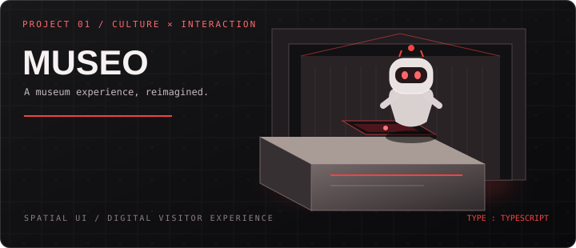</a>

### [MUSEO ↗](https://github.com/Yashrajdesai99/museo)
**A digital museum experience**

Exploring a more immersive way to experience cultural spaces, with a futuristic museum counter concept and a friendly robot guide.

`TypeScript` · `Interactive experience`
</td>
<td width="50%" valign="top">
<a href="https://github.com/Yashrajdesai99/PriceSentinel"></a>

### [PRICESENTINEL ↗](https://github.com/Yashrajdesai99/PriceSentinel)
**Price monitoring in Python**

A practical project focused on monitoring prices and turning small automations into useful tools.

`Python` · `Monitoring`
</td>
</tr>
<tr>
<td width="50%" valign="top">
<a href="https://github.com/Yashrajdesai99/smart-study-tracker">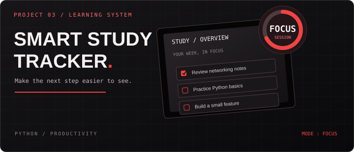</a>

### [SMART STUDY TRACKER ↗](https://github.com/Yashrajdesai99/smart-study-tracker)
**Make learning easier to organise**

A study-tracking project built around tasks, structure, and steady progress.

`Python` · `Productivity`
</td>
<td width="50%" valign="top">
<a href="https://github.com/Yashrajdesai99/Personal-Expense-Tracker">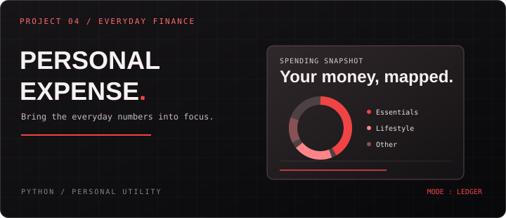</a>

### [PERSONAL EXPENSE TRACKER ↗](https://github.com/Yashrajdesai99/Personal-Expense-Tracker)
**A clearer view of everyday spending**

A Python utility concept for recording and organising personal expenses.

`Python` · `Personal utility`
</td>
</tr>
<tr>
<td width="50%" valign="top">
<a href="https://github.com/Yashrajdesai99/python-journey">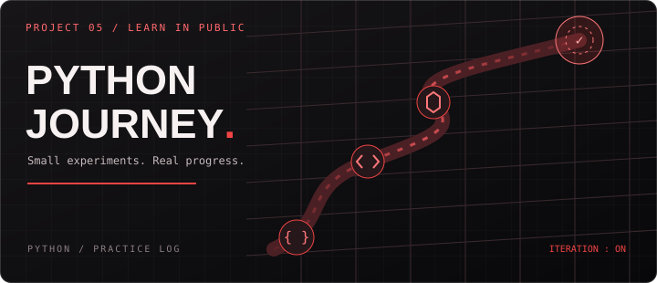</a>

### [PYTHON JOURNEY ↗](https://github.com/Yashrajdesai99/python-journey)
**Learning in public**

A living collection of Python practice, small experiments, and progress through building.

`Python` · `Learning log`
</td>
<td width="50%" valign="top">
<a href="https://github.com/Yashrajdesai99/Yashrajdesai99">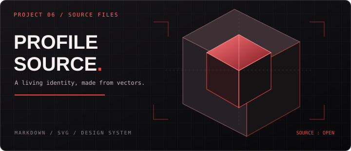</a>

### [PROFILE SOURCE ↗](https://github.com/Yashrajdesai99/Yashrajdesai99)
**This profile, made from vectors**

A custom profile design system with original SVG artwork and an optional interactive companion site.

`Markdown` · `SVG` · `HTML/CSS/JS`
</td>
</tr>
</table>

## 02 / TOOLS I REACH FOR

  

**Languages & development** — Python, Java, JavaScript, TypeScript, HTML, CSS, React, Node.js  
**Data & workflow** — MySQL, Git, GitHub, Linux, VS Code  
**Exploring** — Networking, cybersecurity, AI/ML, interactive 3D

## 03 / THE WORKING RULES

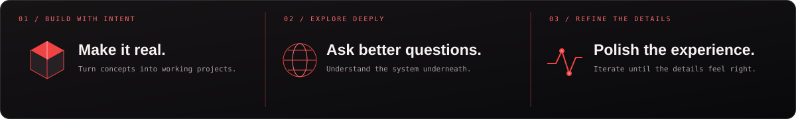

- **Build to understand.** Concepts stick when I turn them into something that works.
- **Explore beneath the surface.** Learn why systems behave as they do, not only how to use them.
- **Design the experience.** Useful software should feel considered, not merely functional.
- **Keep refining.** Every project is another chance to improve the craft.

## 04 / ACTIVITY TRACE

  
  

## 05 / OPEN CHANNEL

Have a useful idea, an interesting technical challenge, or an open-source project that could use another set of hands? [Reach me through GitHub discussions or issues](https://github.com/Yashrajdesai99) and let’s compare notes.


 

<a href="https://github.com/Yashrajdesai99?tab=repositories">BROWSE ALL REPOSITORIES ↗</a>

  

<code>YASHRAJ.EXE</code> &nbsp;—&nbsp; CURIOUS BY DESIGN. BETTER BY ITERATION.

